<div align="center">

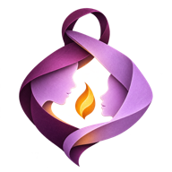

# Samvya

### Context-Aware, Voice-Interactive, Multimodal Support for Students

*A little room to breathe: a wellbeing companion that listens to what a student says and understands the context from facial expression and a wrist wearable. It answers in English, Hindi or Marathi, and hands a clear summary to a human counsellor.*

<br/>


[✨ Features](#-features) •
[🖼️ Screenshots](#️-screenshots) •
[🧠 How it works](#-how-it-works) •
[📊 Results](#-results) •
[⌚ Wearable](#-the-wearable) •
[🚀 Quick start](#-quick-start) •
[🗂️ Structure](#️-project-structure) •
[👥 Team](#-team)

</div>

---

> [!IMPORTANT]
> **Samvya is a research prototype, not a medical device or a substitute for professional care.** Emotion labels and wellness scores are experimental. Wearable readings come from an uncalibrated prototype. Samvya supports students and refers them to people; it never diagnoses.
> **If you or someone you know is in crisis in India, call Tele MANAS on 14416 (24/7, free) or 112 in an emergency.**

## ✨ Features

<table>
<tr>
<td width="50%" valign="top">

### 💬 Counselling conversation
- Warm, short replies generated by **Groq** (`openai/gpt-oss-120b`), chosen *after* an evidence-based intervention is selected
- Text or 🎙️ **voice notes** (Sarvam speech-to-text, streaming)
- Replies in the student's own language and script: **English, Hindi, Marathi** and Hinglish
- 🔊 **Spoken replies** in a female or male counsellor voice (ElevenLabs → Microsoft neural voices → offline Piper → browser), with the first audio in about 1–3 s

</td>
<td width="50%" valign="top">

### 🛡️ Safety first
- Every message is checked by **fixed safety rules** before any AI is involved
- Self-harm risk, including Hinglish phrasing, **bypasses the LLM** and shows a fixed safety check-in with verified Indian helplines (**Tele MANAS 14416**, **112**)
- An LLM guardrail checks inputs and outputs; the model never names helplines itself
- Flagged messages appear at the top of the counsellor report

</td>
</tr>
<tr>
<td width="50%" valign="top">

### 📷 Camera check-in (optional)
- In-browser **MediaPipe Face Landmarker** classifies only *clear* frames: facing the camera, well lit, still, not mid-speech
- An ensemble of **Swin-FANE** (Swin-Base) and **HSEmotion** (EfficientNet-B2)
- Reports a label only when it is confident; otherwise **"Unclear"**
- **Grad-CAM** attention map; pictures are never stored

</td>
<td width="50%" valign="top">

### ⌚ USB wearable
- Seeed **XIAO ESP32-S3** with MAX30102 (PPG), MPU6050 (motion), MAX30205 (skin temperature) and GSR
- Pulse estimated on the computer from the raw 100 Hz waveform: **room-light flicker masked**, **movement-gated**, continuity-checked
- Each tile is **Live / Held / Waiting**; values are never filled in or estimated from other signals
- Checked against a hospital pulse oximeter (pulse 89.6 vs 89 BPM)

</td>
</tr>
<tr>
<td width="50%" valign="top">

### 🧩 Contextual Student State
- Fuses NLP intent and sentiment, camera cues and wearable trends into one **CSS** per turn
- **Intervention selector**: safety support, grounding/breathing, study planning, problem solving, emotional validation, check-in
- A **pipeline inspector** (developer mode) shows every stage live

</td>
<td width="50%" valign="top">

### 📝 Counsellor report
- A one-click **printable report** (`/session/<id>`) for a human counsellor
- LLM-written brief: concerns, the student's own words (verified word for word), circumstances, strengths, follow-up questions
- Camera timeline and wearable summary; session history in SQLite

</td>
</tr>
</table>

## 🖼️ Screenshots

> All screenshots come from the real app with a real webcam and the real wearable. The webcam preview is blurred, and the profile is a demo profile.

<table>
<tr>
<td align="center" width="50%">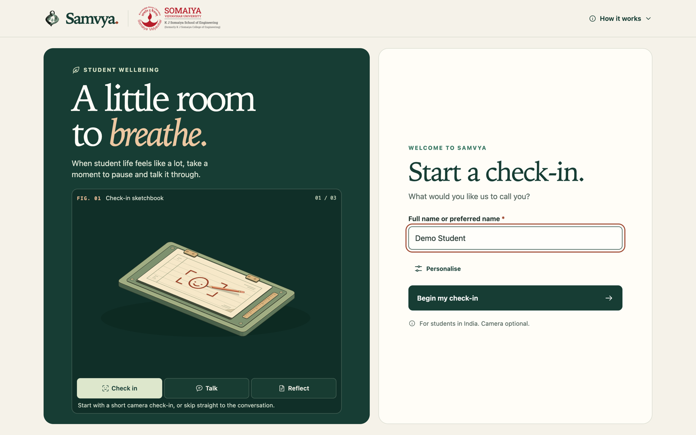<br/><b>Welcome & profile</b></td>
<td align="center" width="50%">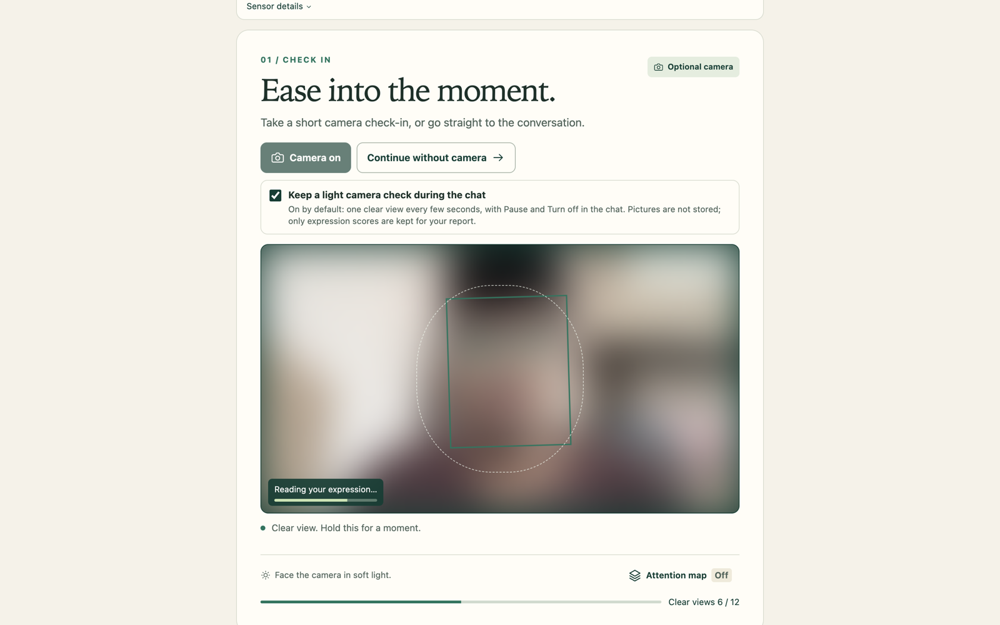<br/><b>Camera check-in: clear views only</b></td>
</tr>
<tr>
<td align="center">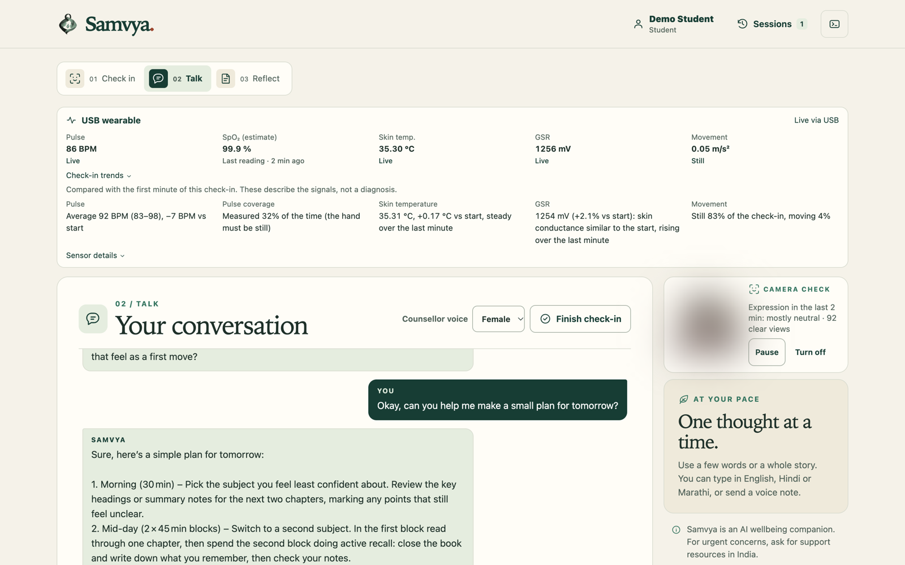<br/><b>Conversation with live wearable tiles</b></td>
<td align="center">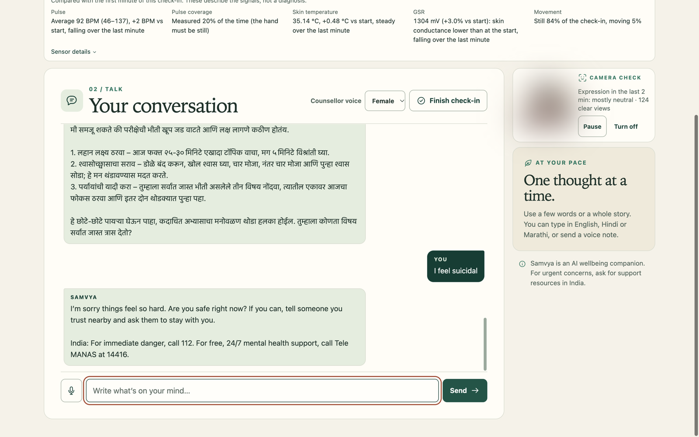<br/><b>Fixed safety check-in (Tele MANAS 14416, 112)</b></td>
</tr>
<tr>
<td align="center">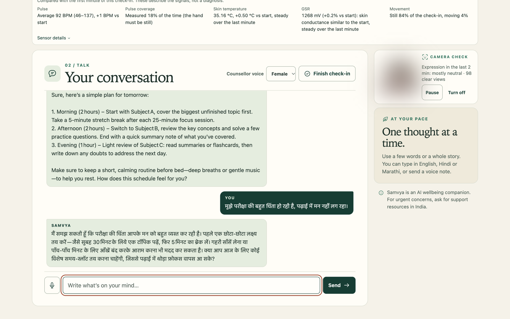<br/><b>हिन्दी: reply in Hindi</b></td>
<td align="center">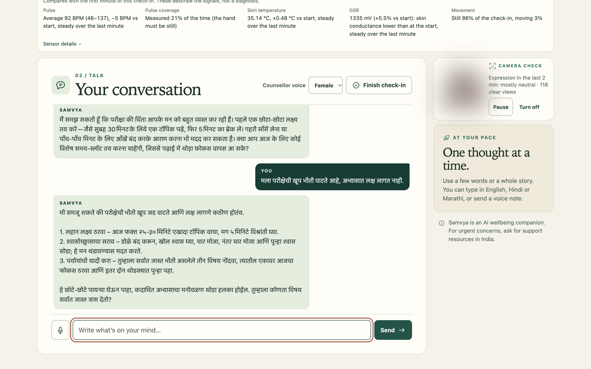<br/><b>मराठी: reply in Marathi</b></td>
</tr>
<tr>
<td align="center">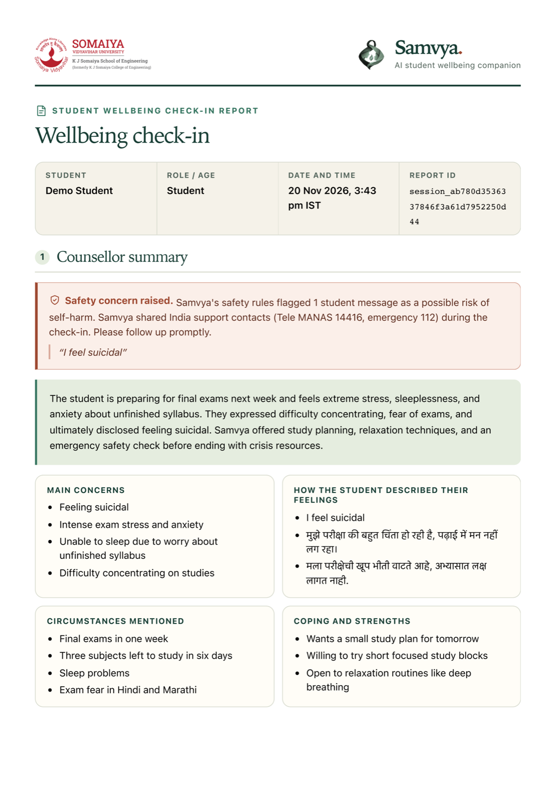<br/><b>Printable counsellor report</b></td>
<td align="center">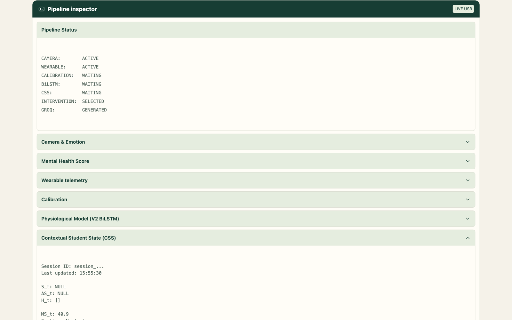<br/><b>Pipeline inspector (developer mode)</b></td>
</tr>
</table>

## 🧠 How it works

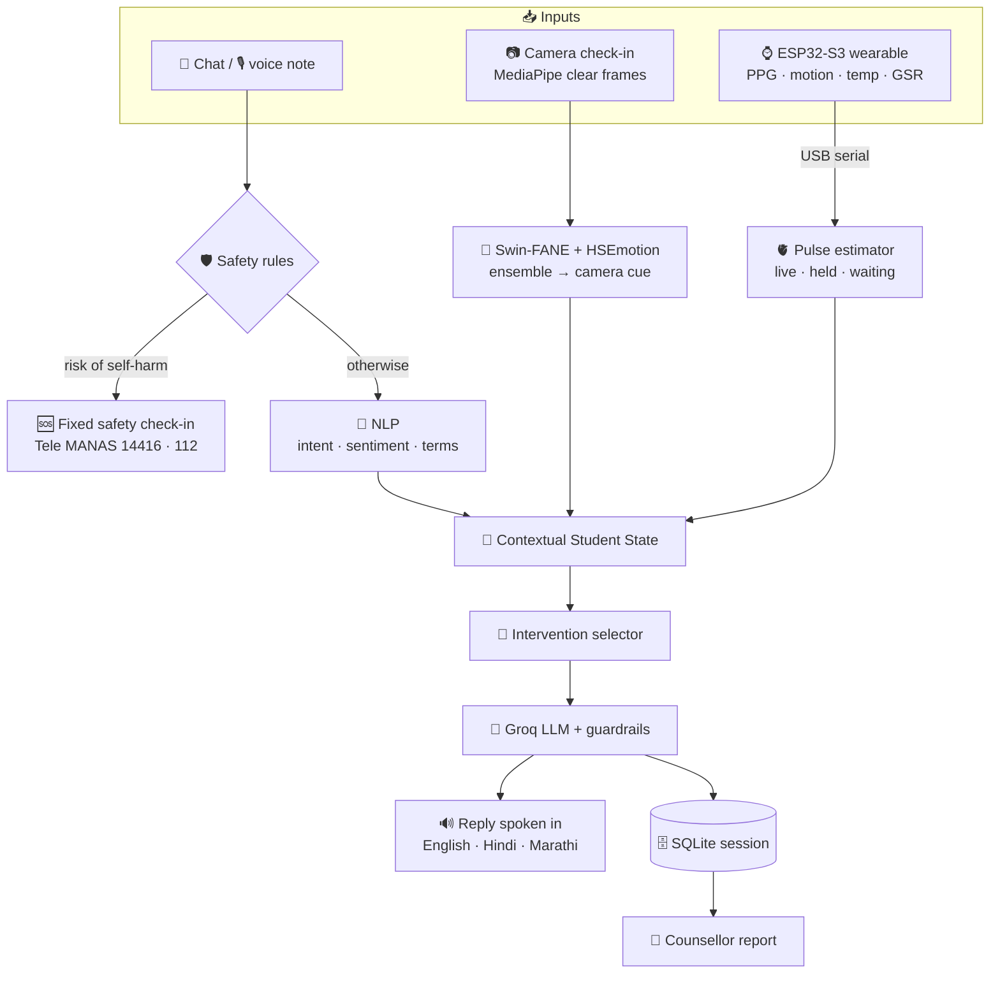

**One chat turn, step by step**
1. 🛡️ **Safety rules** check the message first. A risk of self-harm skips the AI and returns the fixed safety check-in.
2. 🔎 **NLP** extracts intent, sentiment and key terms: 13 intents, 7 sentiments and 388 domain terms with combination rules.
3. 📷 The **camera cue** (only if clear) and ⌚ the **wearable trends** (versus the student's own first minute) are added.
4. 🧩 These are fused into the **Contextual Student State**, and the **intervention** is chosen *before* generation.
5. 🤖 **Groq** writes the reply under strict instructions. A guardrail checks it, and the reply is shown and spoken in the student's language.

## 📊 Results

> Every number below was measured on 20 November 2026 with the scripts in [`report_jobs/`](report_jobs/). Test images were **never seen in training**.

### 📷 Facial expression: 406 unseen FANE test images

| Model | Accuracy | Macro-F1 | Macro-AUC | Accuracy when ≥ 60 % confident (share of images) |
|---|:---:|:---:|:---:|:---:|
| Swin-FANE, original (used in the app) | 67.2 % | 0.570 | 0.923 | 72.5 % (86.9 %) |
| Swin-FANE, **retrained on a de-duplicated split** | 70.4 % | 0.604 | **0.934** | 76.7 % (86.7 %) |
| HSEmotion EfficientNet-B2 (AffectNet) | 49.8 % | 0.417 | 0.797 | 61.3 % (59.9 %) |
| Ensemble: original + HSEmotion | 69.5 % | 0.587 | 0.903 | 85.6 % (51.5 %) |
| 🏆 **Ensemble: retrained + HSEmotion** | **74.1 %** | **0.619** | 0.918 | **88.9 %** (53.4 %) |

<details>
<summary><b>Why not the 90 %+ accuracy from training?</b></summary>

The original FANE train/test split leaked about 90 % of the test images into training, so the old test score (about 91–93 %) measured memorisation. The dataset has 10,343 distinct images in 14,394 files, and 493 carry conflicting labels. The retrained model uses a clean split: duplicates (MD5), near-duplicates (64-bit dHash) and conflicting labels removed, giving 8,030 train / 1,417 validation / 406 test images. It reached its best validation accuracy of 70.85 % at epoch 14 of 15, with the same protocol as the original. The test set has only 5 Sad and 13 Fear faces, which pulls macro-F1 down.

</details>

### ⌚ Wrist-signal stress classifier: WESAD

Subject-wise split: train S2–S11 + S13, validation S14–S15, test S16–S17 (102 windows of 60 s). Adam, 20 epochs, class-weighted, seed 42.

| Model | Test accuracy | F1 | ROC AUC | Best validation F1 |
|---|:---:|:---:|:---:|:---:|
| LSTM | 88.2 % | 0.880 | 0.9996 | 0.607 |
| BiLSTM | 91.2 % | 0.907 | 0.984 | 0.602 |

> [!NOTE]
> The test set holds only two people, and validation F1 on two other people was much lower (about 0.60), so these scores do not show that the model generalises. Treat them as preliminary.

### 🔌 Wearable hardware: one wearer, 20 November 2026

<table>
<tr>
<td width="50%">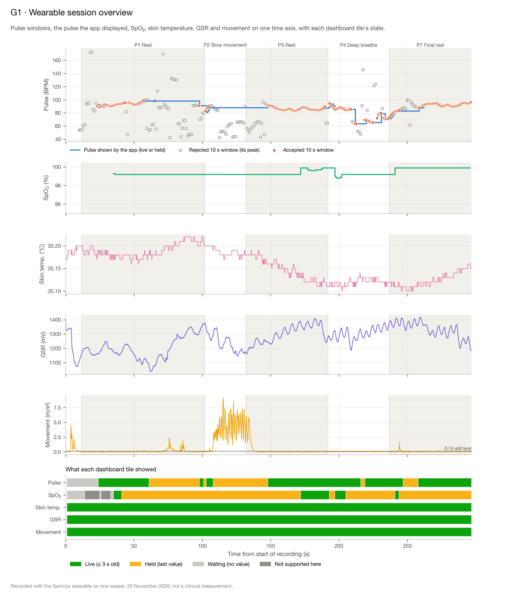</td>
<td width="50%">

- 🫀 **Pulse vs a hospital oximeter:** 89.6 vs 89 BPM and 93.5 vs 94 BPM at rest
- 🩸 **SpO₂:** 97.8–100 % vs 98 % (only indicative, within about 2 %)
- 🌡️ **Skin temperature:** 35.10–35.22 °C over a 5-minute session
- 🎯 **Pulse windows:** 157 of 287 accepted; movement was the main reason for rejection (93 windows)
- 💡 **Room-light flicker** (about 66 BPM) detected and masked in 188 windows
- ✋ GSR is shown as a **voltage / skin-conductance change only**, never as "stress"

</td>
</tr>
</table>

### ✅ Software tests

**213 automated tests pass** (`pytest tests`). They cover NLP and safety routing, guardrails, the intervention selector, camera cues, the pulse estimator, wearable parsing, speech-provider fallbacks, session reports and the end-to-end pipeline. Tests never call the paid AI providers.

## ⌚ The wearable

<table>
<tr>
<td width="50%" valign="top">

| Part | Role | Bus |
|---|---|---|
| Seeed XIAO ESP32-S3 | Microcontroller, USB CDC | — |
| MAX30102 | Red/IR PPG at 100 Hz | I²C 0x57 |
| MPU6050 | Acceleration, rotation | I²C 0x68 |
| MAX30205 | Skin temperature | I²C 0x48 |
| GSR module | Skin conductance (voltage) | GPIO1 (ADC) |

I²C on SDA = GPIO5 (D4), SCL = GPIO6 (D5).

</td>
<td width="50%" valign="top">
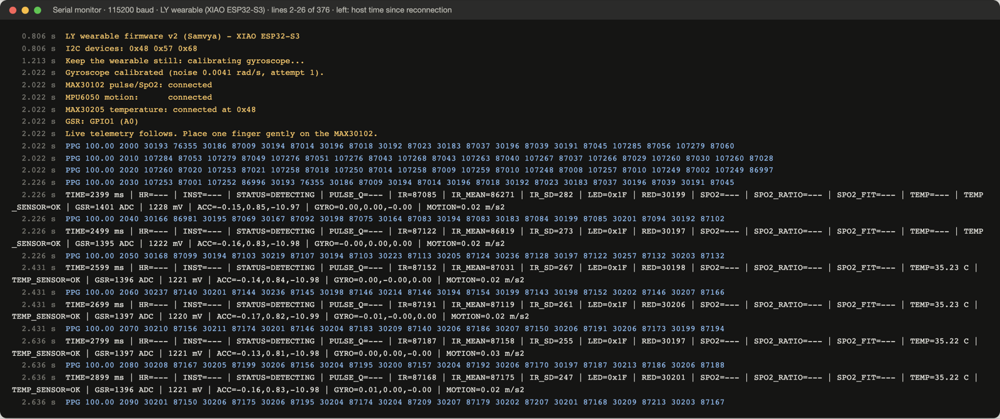
<p align="center"><sub>Real serial output: boot banner, telemetry (10 Hz) and raw PPG lines (100 Hz)</sub></p>
</td>
</tr>
</table>

```bash
# Build & flash (USB Mode: Hardware CDC and JTAG; close Samvya first, because it holds the port)
arduino-cli compile --upload --port /dev/cu.usbmodem101 \
  --fqbn "esp32:esp32:XIAO_ESP32S3:USBMode=hwcdc,CDCOnBoot=default" firmware/LY_Pulse_Acquisition

# Host unit test of the firmware's pulse processing (no board needed)
clang++ -std=c++17 -O2 -Ifirmware/LY_Pulse_Acquisition firmware/tests/ppg_processor_test.cpp -o /tmp/ppg_test && /tmp/ppg_test
```

<details>
<summary><b>🫀 How the pulse is measured (and why it is careful)</b></summary>

Worn on the wrist, the pulse is only 0.02–0.1 % of the light level. The firmware streams the raw red/IR waveform (`PPG` lines, 100 samples/s), and `services/pulse_estimator.py` estimates the pulse on the computer:

- It takes the strongest **infrared** rhythm in a **10 s** window (42–180 BPM).
- **Room-light flicker** (LED lighting aliased by the sensor, about 64–70 BPM with harmonics, mostly in the red channel) is detected and its frequencies ignored (±3 BPM).
- A window counts only if the sensor is on the skin, the rhythm holds at least 28 % of the signal power, the **hand was still** (movement ≤ 0.15 m/s² at the 90th percentile), and the rate is consistent with recent windows (≤ 12 % jump). Rhythmic hand movement produces convincing false pulses, so stillness is essential.
- **SpO₂** (Maxim ratio-of-ratios) is shown only when red and IR move together (correlation ≥ 0.9) in three consecutive windows. It is an uncalibrated estimate.

Tiles stay **Live** for 3 s, are **Held** with their age for up to 10 minutes, and otherwise show **Waiting**. The MPU6050 Z axis reads 1.19 m/s² low on this board and is corrected (`SAMVYA_ACCEL_OFFSET`). The MAX30102 module has its red and IR slots swapped (`SLOT1_IS_IR`). Send `SCAN` over serial for I²C wiring diagnostics, or `RAW` for 10 s of raw samples.

<p align="center">
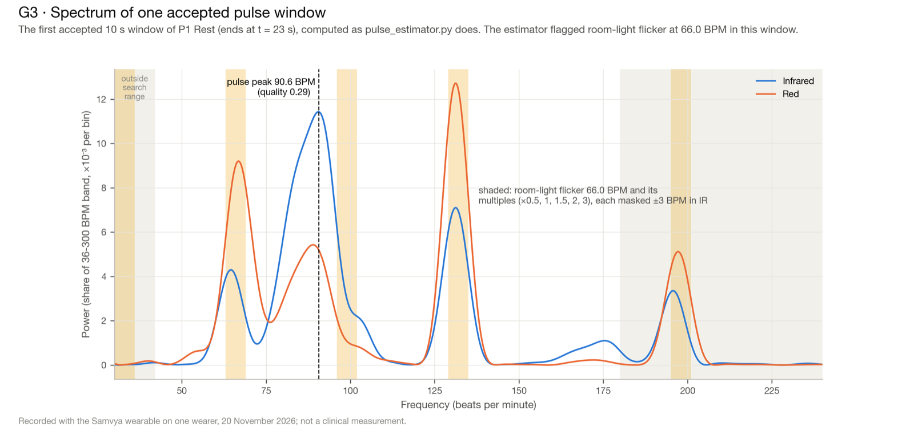
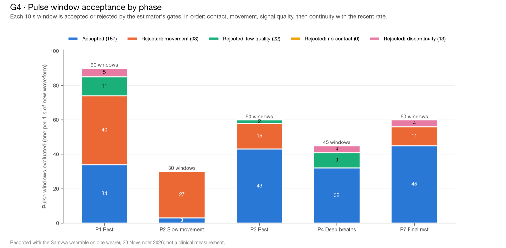
</p>

</details>

<details>
<summary><b>📷 How the camera check-in decides "clear" or "unclear"</b></summary>

- MediaPipe Face Landmarker runs about 15 times a second in the browser and accepts a frame only when: one face is found; it is at least 200 px across; it faces the camera; it is level, lit, still and not mid-speech; and the eyes are open. Otherwise the page says what to change.
- A levelled crop, framed like the training images, goes to `/detect` and is classified by **Swin-FANE** and **HSEmotion**. The two probability sets are averaged.
- The check-in ends after 12 clear views (or 30 s). A label is reported only if the average top probability is ≥ 60 % (ensemble) or ≥ 80 % (Swin alone); otherwise the result is **Unclear** with no score.
- During the chat, one clear view is taken every 3 s, and the sidebar shows the last two minutes. The counsellor model is told never to mention the camera or name an emotion from it.
- MediaPipe is vendored in `static/vendor/mediapipe/` (Apache-2.0, see its `NOTICE.md`), so the camera works offline.

</details>

<details>
<summary><b>🔊 Voices and languages</b></summary>

| Reply language | Voice order |
|---|---|
| Hindi, Marathi | Microsoft neural voice → ElevenLabs → Piper → browser |
| English | ElevenLabs → Microsoft neural voice → Piper → browser |

| Voice source | Female | Male |
|---|---|---|
| ElevenLabs | Sarah | Brian |
| Microsoft (`edge-tts`) | Neerja, Swara, Aarohi | Prabhat, Madhur, Manohar |
| Piper (offline) | lessac, priyamvada, google (mr) | ryan, rohan |

Pronunciation was checked with Sarvam speech-to-text: the Microsoft voices had 0 % character errors in all three languages, and Piper had 7.7 % in Hindi. Hindi and Marathi verbs follow the chosen counsellor's gender (मैं समझ सकती हूँ / सकता हूँ). Marathi and Hindi are told apart by common words and the letter ळ, and a reply that comes back in the wrong one is regenerated once.

</details>

## 🚀 Quick start

**Requirements:** Python 3.10 or 3.11, and a Groq API key for generated replies.

```bash
git clone https://github.com/Madxfury/Context-Aware-Multimodal-Student-Support.git
cd Context-Aware-Multimodal-Student-Support

python3 -m venv .venv
source .venv/bin/activate            # Windows: .venv\Scripts\activate
pip install -r requirements.txt

cp .env.example .env                 # then add your own keys
python app.py
```

Open **http://127.0.0.1:5002** 🎉. The step-by-step usage guide is in [`docs/USAGE.md`](docs/USAGE.md).

<details>
<summary><b>🔑 Configuration (.env)</b></summary>

| Variable | Purpose |
|---|---|
| `GROQ_API_KEY` | Chat replies and counsellor summary (**required** for generated replies) |
| `ELEVENLABS_API_KEY` | Optional English voice |
| `SARVAM_API_KEY` | Optional speech-to-text for voice notes |
| `EMOTION_MODEL_PATH`, `EXPRESSION_MODEL_PATH`, `PHYSIOLOGICAL_MODEL_PATH` | Model locations (defaults are under `Models/`) |
| `PIPER_VOICE_DIR`, `SAMVYA_TTS_ORDER` | Offline voices and voice order |
| `SAMVYA_WEARABLE_PORT`, `SAMVYA_ACCEL_OFFSET` | Wearable serial port (or `off`) and accelerometer offset |
| `DATABASE_PATH`, `PORT`, `SAMVYA_ALLOWED_HOSTS` | Storage and server |

Free-plan limits: Groq allows 8,000 tokens per minute (one turn uses about 1,200–1,500), and ElevenLabs allows 10,000 characters per month. Samvya waits and retries politely, and pauses ElevenLabs when its quota is used up. **Never commit `.env`.**

</details>

<details>
<summary><b>🧠 Model weights (not in this repository)</b></summary>

The app starts without any weights, but camera inference returns HTTP 503 until a checkpoint is present. `/api/health` shows which models are loaded.

| Model | Default path | How to get it |
|---|---|---|
| Swin-FANE (Swin-Base, 349 MB) | `Models/Swin_FANE_Best_Model.pth` | Team checkpoint, or train with `utilities/train_model.ipynb` / `report_jobs/fane_retrain.py` |
| HSEmotion `enet_b2_7.onnx` (31 MB) | `Models/hsemotion/enet_b2_7.onnx` | `curl -L -o Models/hsemotion/enet_b2_7.onnx https://raw.githubusercontent.com/sb-ai-lab/EmotiEffLib/main/models/affectnet_emotions/onnx/enet_b2_7.onnx` |
| WESAD BiLSTM | `Models/Physiological_V2/best_bilstm.pth` | `python scripts/preprocess_wesad_v2.py && python scripts/train_wesad_models.py` (needs WESAD) |
| Piper voices (optional) | `Models/piper/` | [`rhasspy/piper-voices`](https://huggingface.co/rhasspy/piper-voices) |

WESAD is available for non-commercial research from the authors at the University of Siegen: <https://uni-siegen.sciebo.de/s/HGdUkoNlW1Ub0Gx/download>. The Swin checkpoint's classes are in alphabetical (`ImageFolder`) order: Angry, Disgust, Fear, Happy, Neutral, Sad, Surprise.

</details>

### 🧪 Run the tests

```bash
pip install -r requirements-dev.txt
python -m pytest tests          # 213 tests; provider keys are blanked automatically
node --check static/js/main.js
```

## 🗂️ Project structure

```text
📦 Context-Aware-Multimodal-Student-Support
├── 🐍 app.py                    # Flask routes: chat, camera, speech, wearable, reports
├── 🧩 services/                 # core logic
│   ├── nlp_processor.py · nlp_rules.py        # intent, sentiment, safety rules
│   ├── css_manager.py · intervention_selector.py
│   ├── llm_guardrail.py · counsellor_brief.py · reply_text.py
│   ├── camera_cues.py · mental_health_score.py
│   ├── wearable.py · pulse_estimator.py       # USB wearable + pulse/SpO₂ estimation
│   ├── physiological_model.py · physiological_stress.py · synthetic_simulator.py
│   ├── speech_synthesis.py · live_transcription.py
│   └── db_manager.py · india_support.py
├── 📐 schemas/                  # Pydantic models (CSS, NLP, guardrail, intervention, observation)
├── 🎨 templates/ · static/      # website, report page, MediaPipe (vendored), icons
├── 🔌 firmware/                 # ESP32-S3 Arduino sketch + host test
├── 🧪 tests/                    # 213 pytest tests
├── 📈 scripts/                  # WESAD preprocessing, training, evaluation
├── 📊 report_jobs/              # reproducible evaluation: unseen-image test, retraining, WESAD
├── 🛠️ utilities/                # original FANE training notebooks (legacy/ = early prototype)
├── 📚 docs/                     # usage guide, screenshots, figures
├── requirements*.txt · .env.example · LICENSE
```

## 🔒 Privacy and ethics

- 🏠 **Runs locally.** History and report routes have **no login**, so keep the server on your own computer and use demo profiles.
- 📷 **Pictures are never stored**; only expression scores are kept.
- 🚫 **No diagnosis.** Camera cues describe facial expressions, not feelings, and GSR is never presented as stress.
- 🧪 **No fake data.** Simulated wearable values (developer simulator) are never presented as hardware readings.
- 🗝️ API keys live only in `.env`, which is git-ignored.

## 👥 Team

<div align="center">

**Final-year project, LY RAI · K. J. Somaiya School of Engineering (Somaiya Vidyavihar University)**

| 👩‍💻 Team | 🎓 Mentors |
|:---:|:---:|
| Sanskar Parab · Tanisha Saha · Taher Hotelwala | Dr. Pankaj Mishra · Dr. Minendra Surve |

</div>

## 🙏 Acknowledgements

- **FANE** facial-expression dataset; **WESAD** (Schmidt et al., 2018, University of Siegen)
- [**HSEmotion / EmotiEffLib**](https://github.com/sb-ai-lab/EmotiEffLib) (Apache-2.0) · [**MediaPipe**](https://developers.google.com/mediapipe) (Apache-2.0) · [**timm**](https://github.com/huggingface/pytorch-image-models) Swin Transformer
- [**Groq**](https://groq.com), [**Sarvam AI**](https://www.sarvam.ai), [**ElevenLabs**](https://elevenlabs.io), [`edge-tts`](https://github.com/rany2/edge-tts) (LGPL-3.0), [**Piper**](https://github.com/rhasspy/piper) (GPL-3.0)
- Application snapshot originally imported from [Taherhotel/Context-aware-Adaptive-counsellor](https://github.com/Taherhotel/Context-aware-Adaptive-counsellor) (commit `690b140`), which keeps its MIT license

## 📄 License

Released under the [MIT License](LICENSE). Third-party models, voices and datasets keep their own licences (several are **research / non-commercial only**: AffectNet-trained weights, WESAD, some Piper voices).

<div align="center">
<br/>
<sub>Made with 💚 for students who need a little room to breathe.</sub>
</div>
